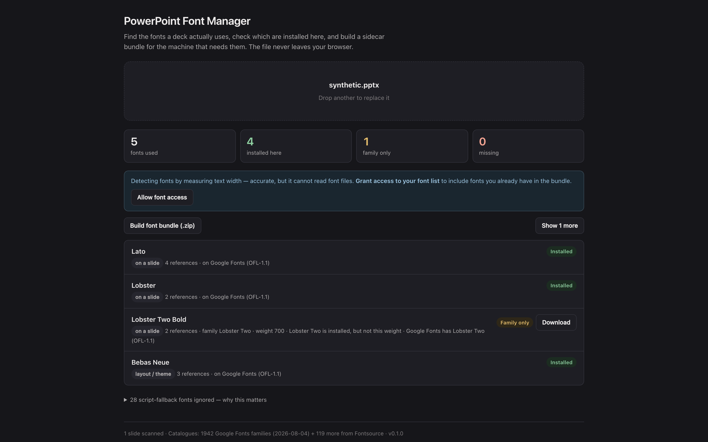

# PowerPoint Font Manager

> **AI-assisted project.** This codebase was created with [Claude](https://claude.com/claude-code)
> (Anthropic), directed and reviewed by a human author. I've checked the scanner
> against three real presentations from different places (one from Canva, one
> from Office with embedded fonts, and a 316 MB deck that names almost no fonts
> explicitly), and checked its installed/missing verdicts font by font against
> CoreText's own list on macOS. The bundle's Windows installer has been run end
> to end on Windows 11 and that's how I caught it unregistering every other
> per-user font on the machine (fixed since). The macOS and Linux installers are
> syntax-checked but haven't been run against a real font install. Check the
> bundle on a spare machine before you rely on it in front of a client.

Drop in a `.pptx` and it tells you which fonts the deck actually uses and which of
those are installed here, then hands you a sidecar `.zip` that installs the rest on
the machine that needs them.

Everything happens in the browser. The deck is never uploaded anywhere.



<sub>The hosted tool with the repo's synthetic test deck (`test/fixtures/synthetic.pptx`) loaded: five fonts found, four installed on the machine that took the picture, one family present but not at the weight the deck asks for, and the bundle ready to build. The deck never left the browser.</sub>

---

## Why not just search the file for font names

Because you get a wrong answer that looks right. Every PowerPoint theme carries
a *script fallback table*, a list of fonts to reach for if the deck ever
contains Japanese, Devanagari, Khmer, Syriac and so on. It's there whether or
not a single such character exists in the presentation.

Searching a real deck for `typeface=` finds **39 fonts**. It uses **two**. The
other 37 are that table, and a tool that lists them will send you off to install
Mongolian Baiti and DokChampa for a slide that says "Welcome" in Calibri.

The second half of the problem is that decks name *faces*, not *families*:

| The deck asks for      | A naive check says | Actually             |
| ---------------------- | ------------------ | -------------------- |
| `Helvetica Neue Medium` | missing            | you have it          |
| `Poppins Regular`       | missing            | you have it          |
| `Times Roman`           | missing            | that's Times New Roman |
| `Garamond`              | missing            | genuinely missing    |

Three false alarms out of four. This tool resolves the names first, so "missing"
means missing.

---

## What it does

**Scans** slides, layouts, masters, notes, charts and SmartArt, resolves theme
references (`+mn-lt` and friends) through the theme the slide actually
inherits, and sorts what it finds by how much it matters: used on a slide,
inherited from a layout or theme, or only present somewhere incidental.

**Checks what's installed**, using the Local Font Access API where the browser
has it, and text-width measurement everywhere else. The fallback was checked
against CoreText on macOS across nine fonts and agreed on all nine.

**Finds replacements** across two catalogues (1,942 Google Fonts families, plus
119 more from Fontsource that Google doesn't carry), matched after the name is
normalised, with near-matches offered when there isn't an exact one (a missing
`Garamond` suggests EB Garamond and Cormorant Garamond).

**Substitutes what can't be shared.** The fonts most often missing are the ones
a deck picks up just by being written on Windows or a Mac: Calibri, Cambria,
Arial, Times New Roman, Courier New, Georgia. None of them may be redistributed
and none are on Google Fonts, so the app offers *metric-compatible* stand-ins
instead: Carlito for Calibri, Caladea for Cambria, Arimo for Arial, Tinos for
Times New Roman. These have the **same advance widths** as the original, so line
breaks hold and text stays inside its box.

Where there's only a visually similar face (Open Sans for Segoe UI), it tells you
so. That swap *will* move your line breaks, and being told the deck is fixed when
it isn't is worse than being told the font is missing.

**Recognises Adobe Fonts.** These can never be bundled. Adobe's terms say the
fonts "are not compatible with packaging workflows that involve transferring
font files to another user or computer", and there's no API that serves the
files anyway. So for a missing one the app gives the reason and links straight
to the family page, where anyone with a Creative Cloud subscription can
activate it.

The desktop app also catches the version of this that looks fine: a font
Creative Cloud syncs onto your machine is installed here and nowhere else, so
the deck looks perfect for you and breaks at the venue. The app tells it apart
from an ordinary installed font by where the file lives (Adobe keeps synced
faces in its own CoreSync folder), which is why *Times New Roman* doesn't get
the warning just for being sold on Adobe Fonts too.

**Reports embedded fonts**, the ones that travel inside the deck and need no
installing at all. Where the format allows, it extracts them as proper
installable files (see below).

**Builds a sidecar `.zip`** containing the fonts, a manifest saying where each
came from and under what licence, and an installer for macOS, Windows and Linux
that writes to the per-user font directory with no administrator password.

---

## Embedded fonts

PowerPoint's "embed fonts in the file" doesn't store a TTF. It stores **EOT**,
and what happens next depends on who wrote the file:

| Written by         | Format                  | Can it be recovered?               |
| ------------------ | ----------------------- | ---------------------------------- |
| PowerPoint         | EOT + MicroType Express | **No** — the glyph data is compressed |
| Canva, LibreOffice | EOT, uncompressed       | **Yes** — extracted as a valid TTF |

Either way the font travels with the deck, so it'll render wherever the
`.pptx` goes. The distinction only matters for what can go in the bundle.

### Embedded, but can the other end edit it?

PowerPoint offers two kinds of embedding, and they promise different things:

| Saved as                       | The recipient can        |
| ------------------------------ | ------------------------ |
| Embed **all** characters       | view, print **and edit** |
| Embed only the characters used | view and print only      |

The second one ships just the glyphs this deck happened to need, so PowerPoint
stops anyone without the font from editing that text. The app reads the
setting and labels each embedded font **editable** or **read-only**.

It also checks the setting against the file, because the setting is a claim
rather than a fact. A Canva deck declares "characters used only" and then
embeds a complete Latin face, so it's marked read-only, with a note that the
face will in fact render anything you add. The reverse happens too, and matters
more: a deck that declares every character while carrying a face cut down to 5
of the 95 printable ASCII characters will let you type and then show you
nothing. That one gets a warning.

PowerPoint's own embedder compresses its payload, so for decks written by
PowerPoint the setting is the only evidence there'll ever be, and the app
says so rather than guessing.

If a cut-down face ends up in a bundle, `MANIFEST.txt` says which characters
it actually has before it lists the filename, because a subsetted font installs
perfectly and then fails on the first character nobody had typed yet.

---

## The bundle, and two traps it works around

There's no such thing as a single self-extracting archive that runs on every
OS (a Windows `.exe` won't run on a Mac). So the bundle is a plain `.zip`
with one small script per platform, and a README that heads off the two ways
these usually go wrong:

- **macOS Gatekeeper.** Anything extracted from a downloaded zip inherits a
  quarantine flag, and double-clicking the installer gets "cannot be opened
  because it is from an unidentified developer". That doesn't mean the script's
  broken. The README gives both ways through, plus the no-script route of
  dropping the fonts on Font Book.
- **Windows Mark-of-the-Web.** PowerShell refuses to run a `.ps1` that came out
  of a downloaded zip. The bundle ships a `.cmd` wrapper that unblocks it, so run
  that one, not the `.ps1`.

Fonts already installed are skipped, never overwritten.

### Licensing

The manifest splits the bundle in two. Fonts from Google Fonts carry OFL-1.1,
Apache-2.0 or UFL-1.0 and are marked free to pass on. Anything taken off your
own machine or extracted from the deck is marked **RESTRICTED**, because font
licences almost never allow redistribution, and permission to *embed* a font
in a document isn't permission to extract it and install it somewhere else. The
bundle is built for moving your own deck between your own machines. Read the
manifest before you send it to anyone.

---

## Video and audio

Fonts aren't the only thing that goes wrong when a deck gets to the venue. The
same scan lists every video and sound in the deck too, and answers the three
questions an operator asks before a show:

**Will it play?** The file extension tells you next to nothing: `.mp4` can hold
H.264 that plays everywhere, HEVC that needs a codec pack on Windows, or 10-bit
H.264 that plays nowhere. The app reads the container and the codec
configuration (profile, bit depth, chroma, resolution, frame rate) and gives a
separate verdict for PowerPoint on **Windows** and on the **Mac**, with the
reason when either is in doubt:

| Found                                   | Windows          | Mac            |
| --------------------------------------- | ---------------- | -------------- |
| MP4 / MOV, H.264 8-bit 4:2:0, AAC       | plays            | plays          |
| H.264 High 10, 4:2:2 or 4:4:4           | will not play    | will not play  |
| H.264 wider than 4096 or taller than 2304 | check it       | plays          |
| HEVC tagged `hvc1`                      | needs codec pack | plays          |
| HEVC tagged `hev1`                      | needs codec pack | will not play  |
| ProRes                                  | will not play    | plays          |
| HAP, DNxHD / DNxHR                      | will not play    | —              |
| WMV / ASF, AVI                          | plays            | will not play  |

PowerPoint doesn't decode video itself (it hands the file to Media Foundation
on Windows and AVFoundation on the Mac), so these verdicts are what those
frameworks can decode, cross-checked against Microsoft's list of supported
formats. They come from documentation and the frameworks' known decoders, not
from playing every combination on both platforms.

**What needs the internet?** Online videos (YouTube, Vimeo, Microsoft Stream,
SharePoint, OneDrive), web add-ins that load a page, old Flash objects, and
hyperlinks to video sites. SharePoint, Stream and OneDrive for work also need
PowerPoint signed in to an account that can see the file, which is a second way
to come unstuck on a borrowed laptop. Stream (Classic) and Flash are reported as
dead, because they are. Videos **linked** from the author's disk rather than
embedded are listed too: they aren't in the file at all.

**Can I have the files?** Each embedded file can be saved on its own, or all of
them as one zip, named after the slide and shape they came from (`Slide 12 -
Walk-in loop.mp4`) with a `MEDIA.txt` that says which slide each belongs to
and how PowerPoint played it (start mode, loop, volume, trim). The files are the
bytes PowerPoint stored, untouched; a PowerPoint trim isn't applied to them,
and `MEDIA.txt` says so.

**And take them out of the show.** For a show where video runs from a media
server rather than PowerPoint, pick the slides (it pre-selects the ones with
video) and download a copy of the deck with those slides **hidden**. Hidden,
not deleted: they stay in the deck and the slideshow steps over them. Only
those slides' XML changes. Every other byte, the media included, is copied
straight across, so a 458 MB deck comes back 150 bytes larger. I checked it by
opening the result in PowerPoint for Mac: no repair prompt, and the chosen slides
hidden, no more and no fewer. Your original file is never modified.

Video on a slide layout or master plays on every slide built from it, and is
reported against each of those slides.

---

## The desktop app

The browser version can tell you a font's missing and hand you a zip. It can't
put the font where the OS looks for it (no browser can). The desktop build is
the same app with that last step joined up: find the missing fonts, fetch them
and **install them**, in one press.

It's also more accurate. It reads the platform's own font registry rather than
measuring text widths, so it resolves *faces* and not just families:
`Helvetica Neue Medium` comes back as installed rather than "the family is
there, the weight might not be".

Fonts go to your own account (`~/Library/Fonts`,
`%LOCALAPPDATA%\Microsoft\Windows\Fonts`, `~/.local/share/fonts`), so no
administrator password is needed, and anything already installed is skipped
rather than overwritten.

```bash
npm run desktop:dev      # run it
npm run desktop:build    # .app / .dmg / NSIS .exe / .deb / .AppImage
```

> **Tested on macOS only, so far.** The Windows and Linux install paths are
> written but have never been run. See [AGENTS.md](AGENTS.md) §9 for what is
> and isn't verified.

## Development

```bash
npm install
npm run dev
npm test
```

Fixtures: the real decks I test with are private and gitignored. Two synthetic
ones are generated and committed, so the suite has something to test on a clean
clone:

```bash
node scripts/make-test-deck.mjs     # fonts
node scripts/make-media-deck.mjs    # video and audio (needs ffmpeg)
```

See [CLAUDE.md](CLAUDE.md) for the full command reference and
[AGENTS.md](AGENTS.md) for the design notes and traps.

<!-- selfhost:start -->
## Run your own copy

PowerPoint Font Manager is a static page, so hosting it yourself is one container serving
the built files — the same files the hosted copy serves, running somewhere that
still works when the venue has no internet.

**Docker.** The image is built by this repo's `docker.yml` workflow on every
push and published as `ghcr.io/stoatworks-labs/pptx-font-manager`:

```bash
docker run -d --name pptx-font-manager --restart unless-stopped -p 8538:80 ghcr.io/stoatworks-labs/pptx-font-manager:latest
```

Or `docker compose up -d` with the [`docker-compose.yml`](docker-compose.yml)
in this repo, which maps the same port. Either way it is then at
`http://localhost:8538/`.

**Unraid.** Search Community Applications for *PowerPoint Font Manager* — the template is
[`templates/pptx-font-manager.xml`](https://github.com/stoatworks-labs/stoatworks-unraid/blob/main/templates/pptx-font-manager.xml)
in [stoatworks-unraid](https://github.com/stoatworks-labs/stoatworks-unraid), which is what the CA feed reads.

**Stoatworks Burrow** lists it under *Self-hosted*, with the compose file a
click away.

The `Dockerfile`, `docker-compose.yml`, `docker/` and the workflow are
generated from `fleet.json` in stoatworks-unraid. Change them there and
regenerate rather than editing them here.
<!-- selfhost:end -->

<!-- attributions:start -->
This project is built on other people's work — see [ATTRIBUTIONS.md](ATTRIBUTIONS.md).
<!-- attributions:end -->

## Licence

MIT. Part of [Stoatworks Labs](https://stoatworks-labs.com).
